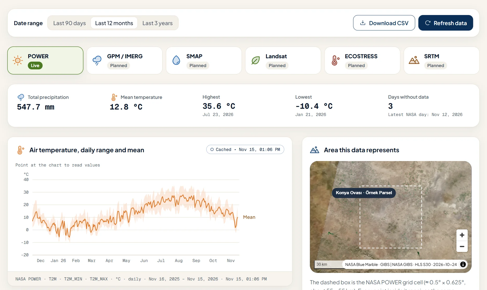

# Sat2Soil

**From Satellite to Soil, From Data to Decisions.**
NASA International Space Apps Challenge 2026 · Konya local event · Challenge: **Field Shift: Adapting Farms with NASA Data**
Team **Hermes Five**: Yunus Emre Atmaz · Ela Nur Göçel · Onur Bayram · Umut Talha Berberoğlu · Mehmet Ali Alkan

Sat2Soil is a decision-support system that combines open NASA Earth data with measurements from inside the farmer's
own field. The web app turns a field's NASA climate record into explainable crop-rotation and water choices; a
handheld field device (physical prototype) adds soil and spray measurements that a satellite grid cell cannot see.
Pilot region: the Konya Plain, Türkiye.

## Links

| | |
|---|---|
| Live web app (EN / TR) | https://sat2-soil.vercel.app — click **Start demo** → Konya sample field |
| API (OpenAPI docs) | https://sat2soil-api.onrender.com/docs (free tier: the first request may take ~1 min to wake up) |
| Project demo, 7 slides (PDF) | [docs/presentation/sat2soil-demo-en.pdf](docs/presentation/sat2soil-demo-en.pdf) |
| Device CAD (STEP) and parts | [hardware/](hardware/) |
| Space Apps project page text | [docs/SPACE_APPS_SUBMISSION.md](docs/SPACE_APPS_SUBMISSION.md) |
| Local-event decks (Turkish) | [jury deck](docs/presentation/sat2soil-sunum-tr.pdf) · [pilot pitch](docs/presentation/sat2soil-pitch-tr.pdf) — PowerPoint versions next to them |



## What is real, what is simulated

| Part | Status |
|---|---|
| NASA POWER climate data, NASA GIBS imagery | **Live** — fetched from NASA for each field |
| Water balance (FAO-56), rotation scoring, digital twin | **Live** — computed on real NASA data |
| Field drawing, field storage (Supabase/PostGIS) | **Live** |
| Field device | **Physical prototype**; does not send data yet → all device values are **simulated** and labelled |
| Mobile app | **Design** (AI-generated mockups, watermarked); not built yet |
| GPM IMERG, SMAP, Landsat NDVI, ECOSTRESS, SRTM | **Planned** — shown as "Planned" in the app, never as live |

Every number in the app carries a source badge and a footer with source, parameter, unit, period and fetch time.

## NASA data

- **NASA POWER** daily API (community AG): `T2M`, `T2M_MIN`, `T2M_MAX`, `PRECTOTCORR`, `RH2M`, `WS2M`,
  `ALLSKY_SFC_SW_DWN` for the field's coordinates, 2004 → today. One POWER grid cell is about 0.5° × 0.625°
  (≈ 55 km), so the app presents it as regional context, not a reading from the field.
- **NASA GIBS** (WMTS): HLS S30 (Harmonized Landsat Sentinel-2) and Blue Marble as the dated basemap for drawing
  fields.
- Space agency partner data: **ESA** Sentinel-2 cloudless (EOX, contains modified Copernicus Sentinel data) as an
  optional high-resolution drawing basemap.

## How it works

1. **Field.** The farmer draws the field on the satellite map. Its centre is matched to a NASA POWER grid cell.
2. **Crop water demand (FAO-56).** Daily reference evapotranspiration ET₀ by the FAO Penman–Monteith method from
   POWER temperature, humidity, wind and radiation; crop demand ETc = Kc × ET₀ with stage-wise crop coefficients;
   water balance = ETc − rainfall. An indicator, not an irrigation prescription.
3. **Crop rotation.** Each 3-year plan is scored: **50 % water fit** (share of the plan's ETc covered by rainfall in
   that grid cell, capped at 100) + **50 % rotation rules** (no repeated crop, no three cereals in a row, at least one
   legume, sugar beet at most once in three years, rainfall covers ≥ 50 % in rain-fed fields). The farmer's current
   plan is compared with the best plan from the crop catalogue; both are editable. On the Konya sample field the
   alternative barley–chickpea–barley needs ~1,091 mm over three years vs ~2,078 mm for sugar beet–wheat–sugar beet.
   Not a yield prediction.
4. **Digital twin.** The season so far uses observed POWER weather; the rest is replayed from each of 20 past seasons
   of the same grid cell (2004–2026). The 10th / 50th / 90th percentiles of the season-end water balance give dry /
   normal / wet outcomes for two crops side by side. Not a forecast.
5. **AgriSpray (device workflow).** Delta T spraying window from air temperature and humidity (Stull 2011), regional
   wind from POWER, 7 measurement points inside the field, and an analysis of a water-sensitive spray card image
   (coverage %, stains per cm², uniformity). Device inputs are simulated today.

### How the data is combined (design for the live device)

Each device reading has position and time, so it is matched to the NASA POWER grid cell and day it belongs to. Soil
moisture readings will correct the model's water-balance state on the day they are taken (simple data assimilation);
EC flags salinity for crop choice; differences between the points show within-field variation the satellite cell
cannot; spray-trace results are read together with that day's wind and temperature. This fusion is designed and will
be validated in the Konya pilot; it is not live yet.

## Repository

```
apps/web/            Next.js 16 web app (TypeScript, Tailwind, MapLibre, Motion) → Vercel
services/api/        FastAPI (Python 3.13): NASA POWER adapter + engines (water, rotation, scenario, spray) → Render
supabase/            PostgreSQL + PostGIS migrations and seed (sample field)
packages/contracts/  Shared Zod schemas / TypeScript types
e2e/                 End-to-end and accessibility tests (Playwright + axe)
hardware/            Device CAD (STEP) and parts list
docs/                Product, data and design documents; presentations in docs/presentation/
```

## Run locally

Requirements: Node ≥ 24, pnpm, Python 3.13 with [uv](https://docs.astral.sh/uv/).

```bash
pnpm install
uv sync --directory services/api
pnpm api:dev     # API on http://localhost:8000 (needs DATABASE_URL, see services/api/.env.example)
pnpm dev         # web on http://localhost:3000
pnpm check       # lint, typecheck, unit tests (web + API)
pnpm e2e         # end-to-end + accessibility tests (web and API running)
```

## Use of AI (Space Apps "SI")

Code was written with the help of an AI coding assistant and is covered by tests. The landing animation, the mobile
app mockups and the device product render are AI-generated and labelled/watermarked as such. The device CAD and
exploded view are the team's own work. The decision engines are transparent calculations, not AI models.

## References

FAO Irrigation and Drainage Paper 56 (Allen et al., 1998) · Stull (2011), wet-bulb temperature from RH and air
temperature · NASA POWER, NASA GIBS · EOX Sentinel-2 cloudless · OpenStreetMap Nominatim · MapLibre GL JS, terra-draw.
Sat2Soil is a support tool: it shows patterns and trade-offs and does not replace the farmer's judgment or local
agricultural expertise.
