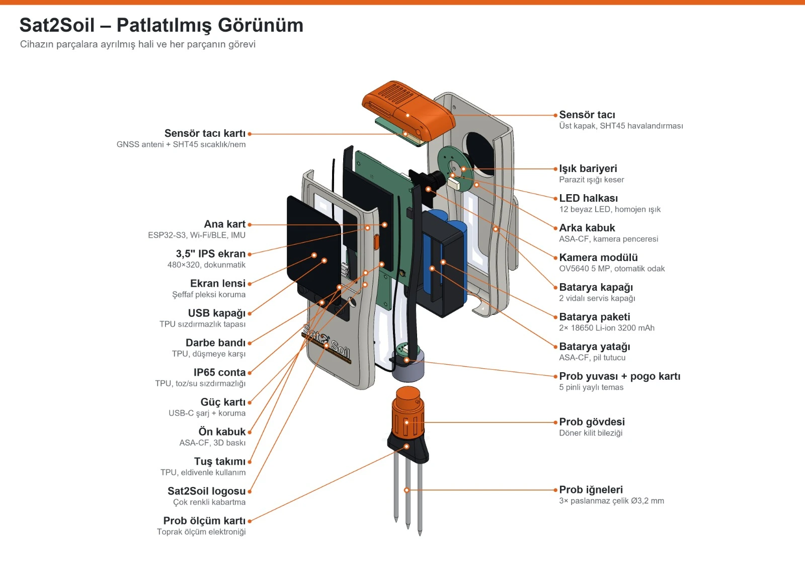
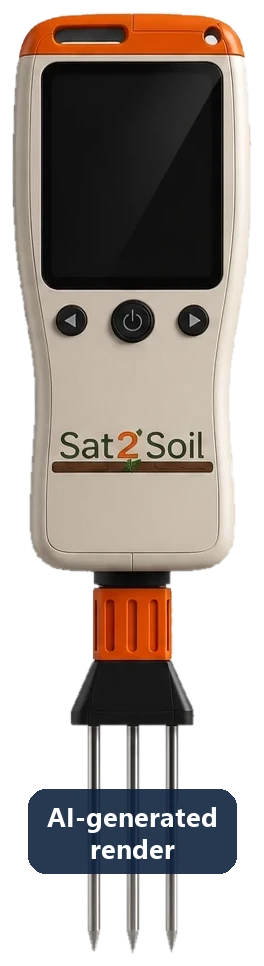

# Sat2Soil field device · hardware

A handheld device that adds what a satellite grid cell cannot see: soil moisture, soil temperature and electrical
conductivity (EC) at points inside the field, air temperature/humidity at spraying time, and a macro photo of the leaf
to check visible spray coverage. Every reading is tagged with GNSS position and time, and is sent to the phone over
Bluetooth LE or the device's own Wi-Fi, so it works in the field without internet.

**Status (15 November 2026):** CAD design complete and a physical prototype built by the team's mechatronics group.
The prototype **does not send data yet**; every device value shown in the web app is simulated and labelled
"Prototype · simulated data".

| | |
|---|---|
|  |  |
| Exploded view from our SolidWorks model (labels in Turkish, translated below) | Product render — **AI-generated**, watermarked |

## CAD file

[`cad/Sat2Soil.step`](cad/Sat2Soil.step) — full assembly, STEP AP214, exported from SolidWorks 2024, units mm,
36 parts/sub-assemblies (~42 MB).

Open it with any STEP viewer, for example [FreeCAD](https://www.freecad.org) (free), eDrawings, Fusion or an online
STEP viewer. GitHub cannot preview STEP files: use **Download raw file**.

## Parts

Part names in the file are Turkish; this is the translation.

| Name in CAD | Part | Role |
|---|---|---|
| `Sat2Soil_Cihaz` | Device | Top-level assembly |
| `Govde` | Housing | Sub-assembly |
| `on_kabuk` | Front shell | ASA-CF, 3D printed |
| `arka_kabuk` | Back shell | ASA-CF, camera window |
| `darbe_bandi` | Bumper band | TPU, drop protection |
| `conta_ip65` | IP65 gasket | TPU, dust/water sealing |
| `ekran_lensi`, `ekran_baskisi` | Screen lens, screen print | Clear acrylic cover |
| `tft_ekran` | 3.5" IPS display | 480×320, touch |
| `tus_takimi`, `guc_tusu` | Keypad, power button | TPU, usable with gloves |
| `usb_kapagi` | USB cover | TPU plug |
| `logo_sat2soil` | Logo | Multi-colour emboss |
| `sensor_taci` | Sensor crown | Top cap, SHT45 vent |
| `kamera_modulu`, `kamera_penceresi` | Camera module, camera window | OV5640 5 MP autofocus |
| `isik_bariyeri` | Light shield | Blocks stray light |
| `batarya_hucreleri` | Battery cells | 2× 18650 Li-ion, 3200 mAh |
| `batarya_yatagi`, `batarya_kapagi` | Battery holder, battery cover | ASA-CF, 2-screw service cover |
| `kapak_vidalari`, `arka_vidalar` | Cover screws, back screws | Fasteners |
| `Elektronik` | Electronics | Sub-assembly |
| `PCB_Ana_Kart` | Main board | ESP32-S3, Wi-Fi/BLE, IMU |
| `PCB_Guc_Karti` | Power board | USB-C charging + protection |
| `PCB_LED_Halka` | LED ring | 12 white LEDs, even light for leaf photos |
| `PCB_Sensor_Taci` | Sensor crown board | GNSS antenna + SHT45 temperature/humidity |
| `Toprak_Probu` | Soil probe | Sub-assembly, swappable |
| `prob_yuvasi` | Probe socket | 5-pin spring (pogo) contacts |
| `prob_govdesi`, `prob_bilezigi`, `prob_basligi` | Probe body, twist-lock ring, probe head | Quick swap |
| `prob_ignelari` | Probe pins | 3× stainless steel, Ø3.2 mm |
| `PCB_Prob_Olcum`, `PCB_Prob_Kontak`, `PCB_Prob_Yuvasi` | Probe measurement, contact and socket boards | Soil measurement electronics |

## What it measures, and what it does not

| Property | Plan |
|---|---|
| Soil moisture, soil temperature, EC | Measured by the 3-pin probe |
| Air temperature and humidity | SHT45 in the sensor crown (spraying conditions, Delta T) |
| Visible spray trace on leaves | Macro camera + LED ring; on-phone model (SprayVision) to be trained and validated |
| pH | Possible with a separate, suitable probe |
| N, P, K; organic matter; soil texture | Not measured; needs lab analysis or farmer records |

EC alone does not show fertility or nutrient content. The device supports decisions; it does not replace a soil lab,
dose advice or disease diagnosis.

## How it connects to the app

1. The farmer draws the field and its measurement points in the app.
2. At each point the device records soil values, air values and a leaf photo with position and time.
3. Readings go to the phone over BLE (small sensor data) or local Wi-Fi (photos), no internet needed.
4. When online, each reading is matched to the NASA POWER grid cell and day of its position, and the field report is
   updated (see the root README, "How the data is combined").

Credits: CAD and exploded view by the Sat2Soil team (Hermes Five). The product render is AI-generated.
